<div align="center">

# Mosaic OS

**A Quickshell desktop for Hyprland: a liquid island, a glass dock and themes that change colors *and* shapes.**

My second rice.

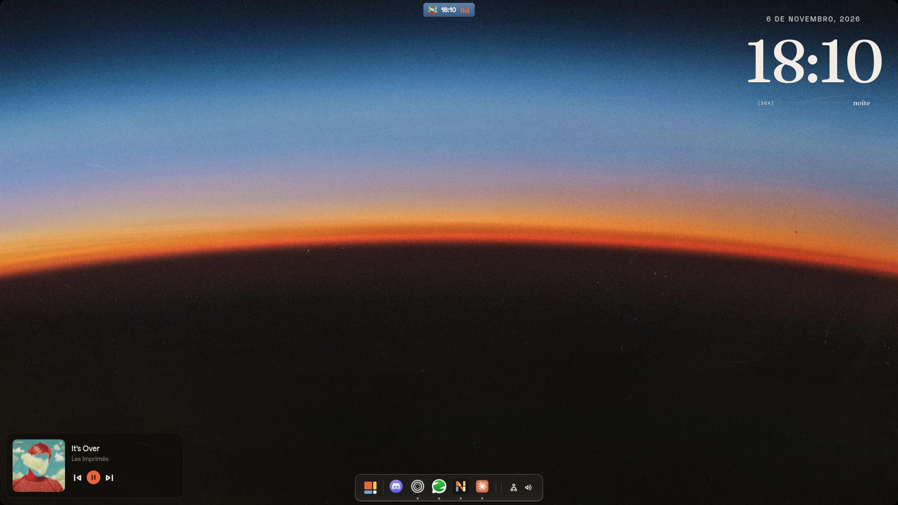

</div>

> [!NOTE]
> **About authorship:** the QML code was written with the help of **Claude** (Anthropic's AI). **The whole visual idea, the design and the mockups are mine.** Every screen, animation and theme started as my sketch and my direction; Claude helped turn them into code.

---

## What's new

- **Desktop widgets from [impasto](https://github.com/andreumassanet/impasto)**, by Andreu Massanet Felix. The Apple-style widget system (clock, weather, calendar, music, lyrics, spectrum, system stats, GitHub, Claude usage, notes, photos and more) now lives on the desktop, restyled for every theme:
  - **Mosaic:** solid mosaic-ui cards with pixel symbols;
  - **Gruvbox:** die-cut stickers;
  - **Horizonte:** analogue instruments;
  - **macOS:** Apple-shaped faces under liquid glass.
  
  Each widget has its own settings in the arranging inspector (city, user, photo folder, 24 h clock, digital clock...).
- **Lock screen,** also from impasto, plus a macOS-style lock for the macOS theme.
- **macOS theme:** Inter fonts, a menu bar fused to the island's notch, a compact dock and liquid glass with bent edges on every widget.
- **The island follows your work:** git commits and pushes show up in it (a global git hook), and so does Claude Code when it finishes or needs you, with your Claude usage in the top band.
- **Mosaic-ui pixel wave** when you change wallpapers in the Mosaic theme: the desktop widgets ride the same wave instead of disappearing. The other themes keep the liquid spread.
- **Sidebars in mosaic-ui style** (Mosaic theme): keys that sink when pressed, block sliders, a tile calendar and a still dot field behind them.
- **Lighter on the GPU:** nothing animates on its own anymore when you are not looking (the dot field moves only when you click the desktop), and <kbd>Super</kbd> <kbd>Alt</kbd> <kbd>G</kbd> opens a panel that switches parts of the shell off, to see what costs what.
- **House wallpapers** generated by code (`scripts/wallpapers/gerar-mosaic.py`), made to match the desktop.

## Demo

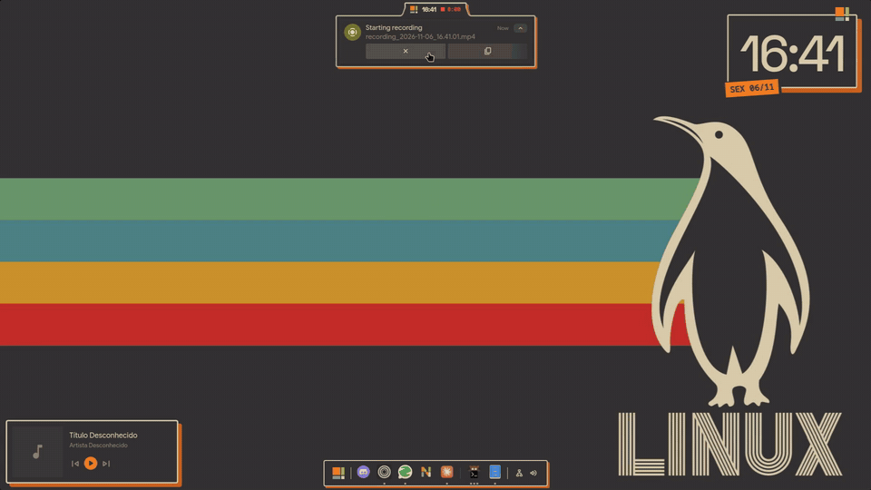

## Features

- **The island:** a floating pill at the top of the screen that morphs with spring physics. It turns into:
  - a quick panel (weather, music, toggles, tray, record button);
  - a compass of the workspaces (hold <kbd>Super</kbd>);
  - live events: volume, brightness, music, screenshots, charging and phone calls (KDE Connect).
- **Liquid notifications:** they drop out of the island as a goo bubble and melt back into it (SDF shaders).
- **Start menu and quick notes,** each in a card fused to the island.
- **Glass dock** with a subtle macOS-style wave. It shows on an empty desktop, hides over windows and comes back when you touch the bottom edge.
- **Sidebars:**
  - left: translator, to-do list and AI chat;
  - right: quick toggles, sliders, phone, calendar and notifications.
- **Screen recorder:** full screen with system audio, mic or no sound, plus a live recording indicator in the island.
- **Top band:** a reserved strip with the workspaces on the left (the active one is a pill that stretches like a worm between them) and a few states on the right: recording, caffeine, updates, do not disturb, Bluetooth, offline, muted.
- **Wallpaper carousel:** slanted cards over the selected wallpaper, blurred, with search and color filters. In the Mosaic theme the new wallpaper comes in on the **mosaic-ui pixel wave**, and the desktop widgets join it; the other themes use a liquid spread that can trace the character's outline.
- **Desktop widgets** (from impasto): a grid of Apple-style widgets on the desktop, arranged by drag and drop, each with its own settings, in a different style per theme.
- **Workspace map** (<kbd>Super</kbd> <kbd>Tab</kbd>) with the real windows, and a **Stage Manager** on the left edge.
- **Launcher modes** in the start menu: `#` clipboard, `>` actions, `@` open windows, timers (`5m tea`), math, and apps ranked by how often you open them.
- **Settings window:** themes, desktop widget toggles, recording settings, plus glass, transparency, darkness and grain for the island, the widgets, the dock and every app.
- **Liquid glass** on the island, dock and sidebars through the hyprglass plugin, adjustable from the UI.

## Themes

A theme here is **colors, shapes and style**. It paints the shell, Hyprland (borders and corners), kitty with the starship prompt, Neovim, the Mosaic Store and the Zen browser.

| | |
|---|---|
| **Mosaic**<br>Soft glass and round pills. All colors come from the wallpaper (Matugen). | 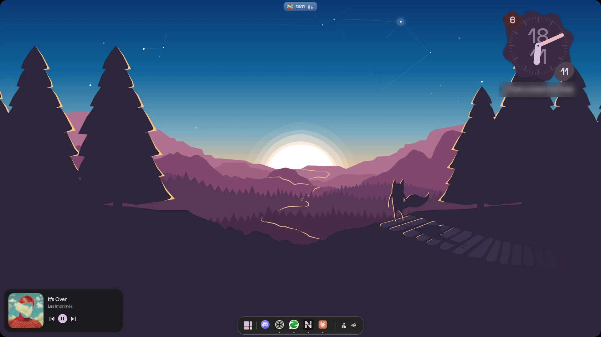 |
| **Gruvbox**<br>Warm neo-brutalism: square shapes, solid surfaces, cream outlines and hard orange shadows that buttons sink into. | 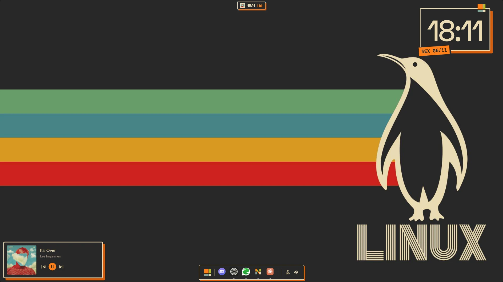 |
| **macOS**<br>Inter fonts, a translucent menu bar fused to the island's notch, a compact dock, Apple-shaped widgets and liquid glass with bent edges. Its own lock screen. | |
| **Horizonte**<br>Dark only, a 70s sunset: a navy sky, an orange horizon, serif titles and film grain on everything. A Hyprland screen shader puts the grain on the apps too, and it turns itself off in full screen games. |  |

## Gallery

### The island

| Mosaic | Gruvbox | Horizonte |
|---|---|---|
| 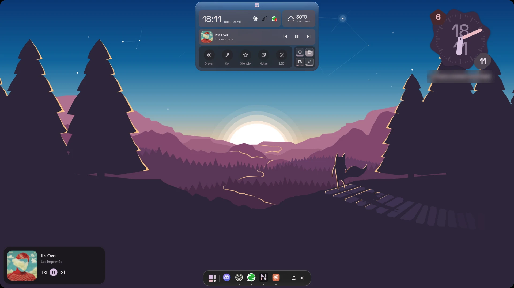 | 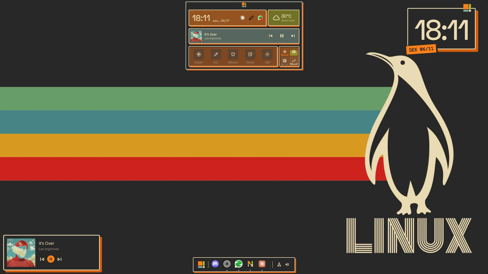 | 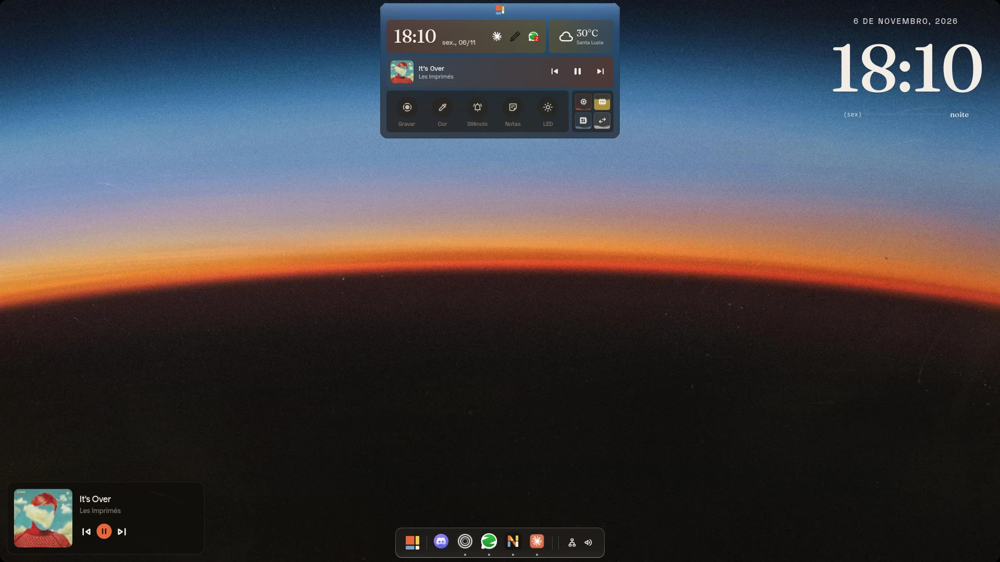 |

### Sidebars

| Right (Mosaic) | Right (Gruvbox) | Right (Horizonte) | Left (Horizonte) |
|---|---|---|---|
| 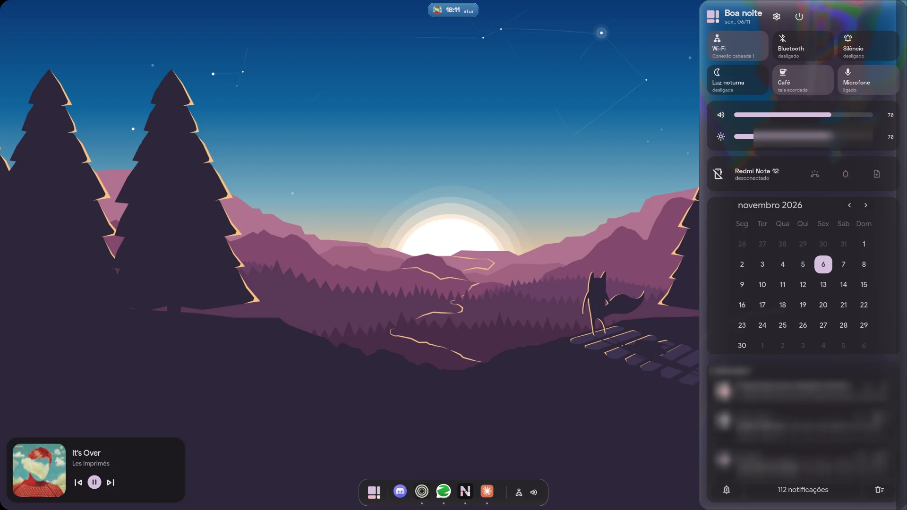 | 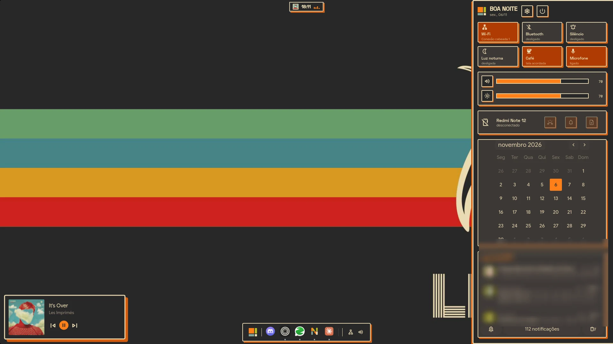 | 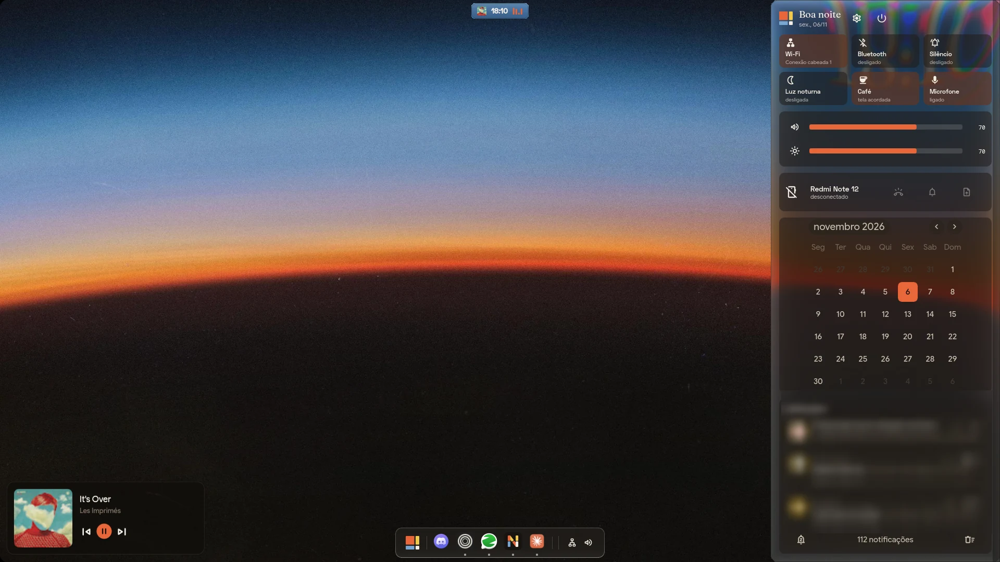 | 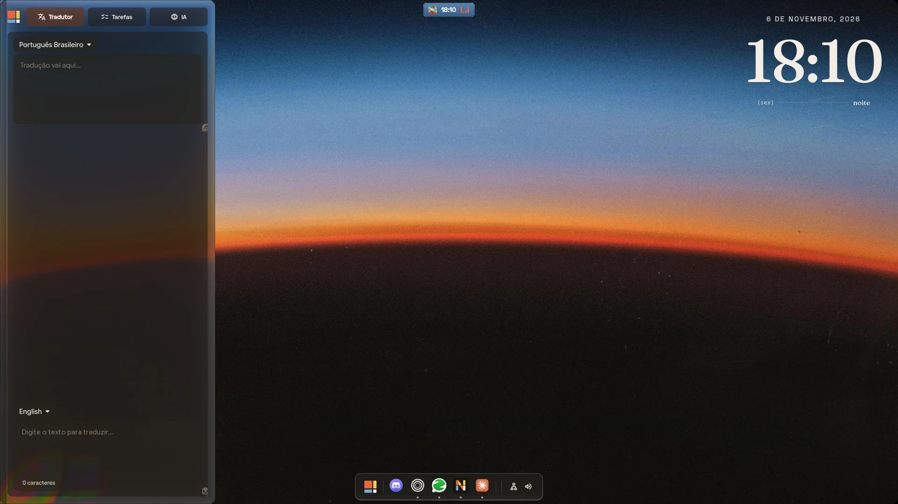 |

### Wallpaper and theme window

| Wallpapers (Gruvbox) | Wallpapers (Mosaic) | Look settings and grain (Horizonte) |
|---|---|---|
| 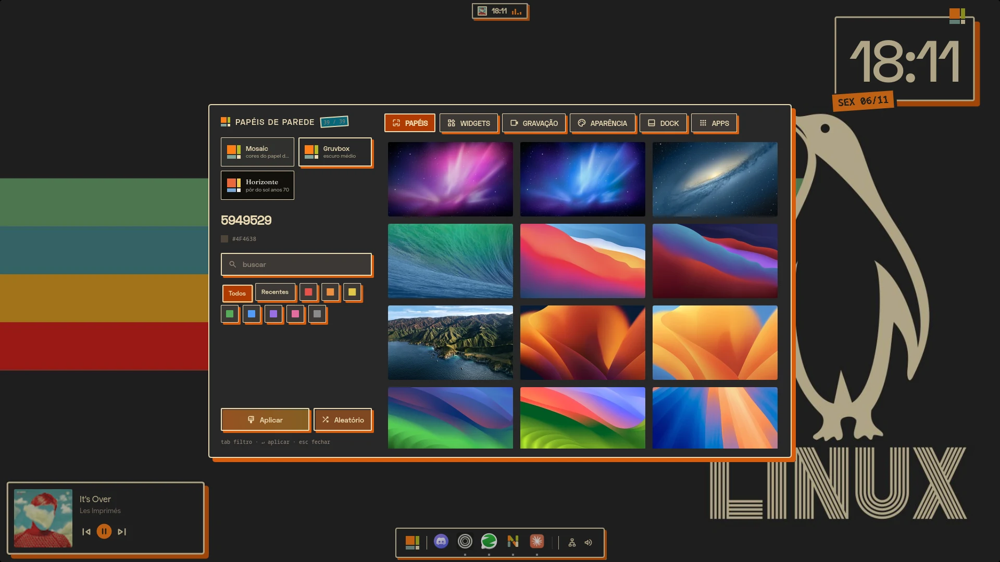 | 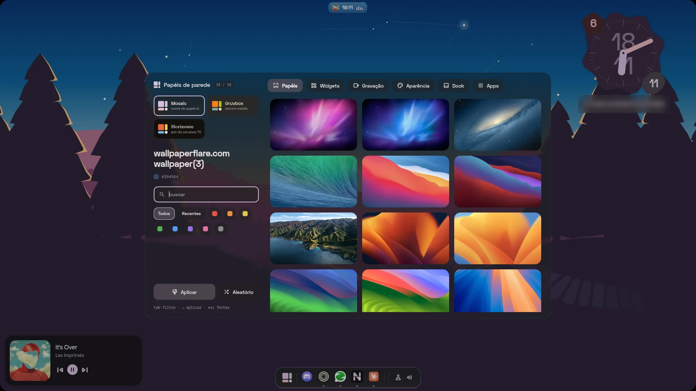 | 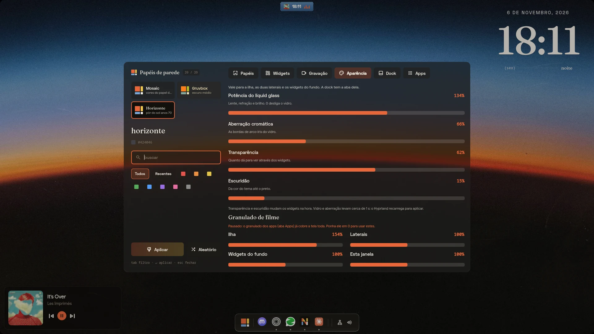 |

### Start menu

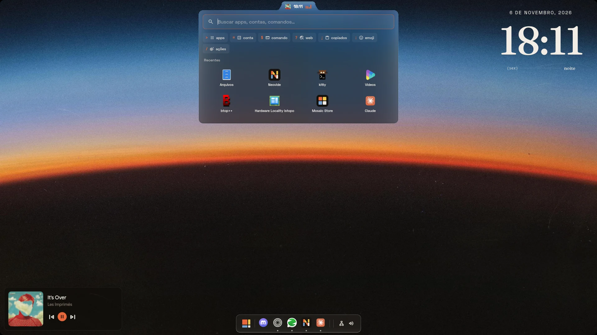

## Requirements

- **Hyprland 0.57+** with the Lua config.
- **Quickshell.**
- **hyprglass** plugin, for the liquid glass.
- **Matugen 4,** for the wallpaper colors.
- **gpu-screen-recorder** or **wf-recorder,** for screen recording.
- **cava,** for the music spectrum widgets.
- **KDE Connect,** optional, for the phone events.
- **Fonts:**
  - Space Grotesk and JetBrains Mono;
  - Fraunces (`ttf-fraunces-variable`), for the Horizonte titles;
  - Inter and Inter Display, for the macOS theme.

## Install

Mosaic OS lives next to [illogical-impulse](https://github.com/end-4/dots-hyprland) and swaps with it, so start from a working illogical-impulse setup.

```bash
git clone https://github.com/amendoa657/mosaicOS ~/.config/quickshell/mosaic
```

```bash
~/.config/quickshell/mosaic/scripts/mosaic-os.sh ligar
```

`hypr/mosaic.lua` holds the glass presets and the keybinds; source it from your Hyprland config. To go back to illogical-impulse:

```bash
~/.config/quickshell/mosaic/scripts/mosaic-os.sh desligar
```

## Keybinds

| Keys | What it does |
|---|---|
| <kbd>Super</kbd> | Start menu (hold it for the workspace compass) |
| <kbd>Ctrl</kbd> <kbd>Super</kbd> <kbd>M</kbd> | Switch between Mosaic OS and illogical-impulse |
| <kbd>Super</kbd> <kbd>Alt</kbd> <kbd>N</kbd> | Quick notes |
| <kbd>Super</kbd> <kbd>Tab</kbd> | Workspace map |
| <kbd>Super</kbd> <kbd>Shift</kbd> <kbd>Tab</kbd> | Stage Manager on/off |
| <kbd>Super</kbd> <kbd>Alt</kbd> <kbd>T</kbd> | Settings and themes |
| <kbd>Super</kbd> <kbd>Alt</kbd> <kbd>G</kbd> | Switch parts of the shell off (find what weighs on the GPU) |

Everything also has an IPC, for example:

```bash
qs -c mosaic ipc call theme set horizonte
```

## Docs

- [`DOCS.md`](DOCS.md): every part of the code explained, from the shaders and springs to the theme system (in Portuguese).
- [`VISAO.md`](VISAO.md): the design decisions, in order (in Portuguese).

## Credits

- [end-4/dots-hyprland](https://github.com/end-4/dots-hyprland) (illogical-impulse): the shell Mosaic OS started from. Its services and many of its widgets are still underneath.
- hyprdots: ideas for the floating island and the wallpaper index.
- [pocket-dots](https://github.com/diegoMalagrida/pocket-dots) (GPL-3.0): ideas for the wallpaper carousel, the pixel-colony transition, the top band, the Stage Manager and the launcher modes.
- **[impasto](https://github.com/andreumassanet/impasto) by Andreu Massanet Felix** (GPL-3.0): the whole desktop widget system and the lock screen. The code lives in `desk/`, vendored and adapted: its widget faces, services, arranging grid, inspector and lock all come from impasto; Mosaic OS restyled them per theme, added a few widgets and connected them to its own services. If you like the widgets, go give impasto a star.
- hyprglass: the liquid glass.
- **Wallpapers** belong to their authors. The Horizonte wallpaper is the hero image from Anthropic's Claude Opus 5.5 page.

## License

Mosaic OS is built on illogical-impulse, which is licensed under the GPL-3.0, so this project follows the same license.
